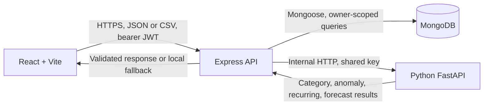
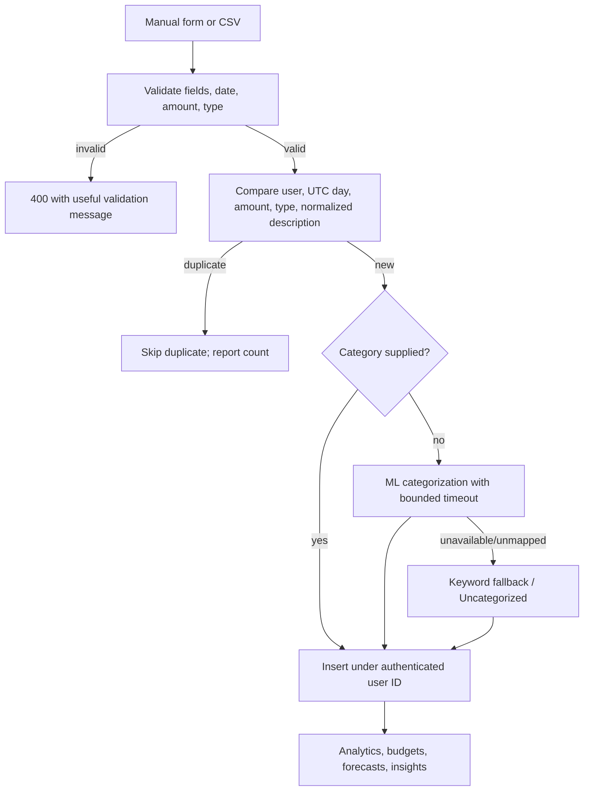

# SpendSense Project Architecture

## 1. Problem statement

SpendSense helps a person record income and expenses, understand category and time-based spending, plan budgets, and get history-based forecasts and alerts. Financial records are private to their owner; the Node API is the authority for identity, validation, calculations, and persistence.

## 2. Architecture



**Request flow:** the frontend's Axios client uses `VITE_API_BASE_URL`, attaches the stored bearer token, and has a 15-second request timeout. Express assigns a request ID, sets security headers, checks CORS, parses bounded request bodies, and dispatches to the route. Private route groups use `protect` before their controllers.

## 3. Technology choices

- **React + Vite:** existing client-side finance pages and components; no server-rendering requirement is present.
- **Node.js + Express:** one API boundary owns authentication, authorization, validation, business calculations, and orchestration.
- **MongoDB + Mongoose:** user-scoped document storage and aggregation for financial summaries.
- **Python FastAPI:** isolated statistical/rule-based categorization, anomaly, recurring, and forecast functions. It is not a second system of record.

## 4. Database design

`User` owns authentication, preferences, and profile data. `Transaction` stores `userId`, date, description, numeric amount, credit/debit type, category, and source. `Budget` is unique per user/category. `Anomaly` refers to its user and transaction and is unique by that pair. Forecast, insight, notification, and recurring-expense models support the existing product flows.

Useful indexes currently include transaction `{ userId, date }`, transaction `{ userId, category, type, date }`, unique budget `{ userId, category }`, and unique anomaly `{ userId, transactionId }`. Private query filters always include the authenticated user ID. Analytics aggregate only matching records and group in MongoDB rather than returning every matching document.

Amounts remain JSON numbers and Mongoose `Number` values for compatibility with existing records and clients. New analytics summaries round to two decimal places, but binary floating-point storage is not exact decimal accounting. A switch to integer minor units or Decimal128 needs a planned data migration and API compatibility review; it is not silently mixed into this change. The existing UI and insight text are INR-formatted even though profile settings offer USD; multi-currency display/conversion is not currently complete, and values from different currencies must not be combined without conversion.

## 5. Authentication flow

```mermaid
sequenceDiagram
  participant Browser
  participant API as Express
  participant DB as MongoDB
  Browser->>API: Register/login credentials
  API->>DB: Validate account; persist/read bcrypt hash
  API-->>Browser: JWT (30-day expiry) + public user
  Browser->>API: Authorization: Bearer JWT
  API->>API: Verify signature and token version
  API->>DB: Load authenticated user
  API->>API: Scope controller queries to user ID
```

Registration and login are rate-limited in-process. Password changes increment `tokenVersion`, invalidating older access tokens. Password hashes and token versions are excluded from serialized user data. The existing browser stores bearer tokens in Web Storage; this retains an XSS exposure risk and has not been replaced with a different auth architecture.

## 6. Transaction ingestion flow



CSV is buffered with a 5 MB file limit, validates its supported headers/rows, and accepts at most 5,000 data rows. Imports are preflight-deduplicated against that user's records and within the uploaded file; rows with explicit categories bypass ML. The check is not atomic across two simultaneous imports, so concurrent uploads can still race; strict cross-process idempotency would require a persisted fingerprint and a backfill/index migration.

`GET /api/transactions` supports server-side filters, sorting, and offset pagination with a maximum page size of 100. The UI therefore renders one bounded page rather than the entire history.

Date-only input is stored at UTC midnight; ISO timestamps without a timezone are interpreted as UTC by the transaction parser. Calendar analytics use the API host's local month/week boundaries; deployments should keep the service timezone consistent (UTC is recommended).

## 7. API quality and contracts

Read/list operations use `GET`; creation uses `POST` and returns `201`; invalid input returns `400`; missing/invalid authentication returns `401`; another user's or missing record returns `404`; duplicate-key conflicts return `409`; oversized CSV/body requests return `413`. Success and error payloads share the existing response helpers, with a request ID attached to routed server failures. Transaction pagination includes total records, current page, page size, and total pages. Existing update routes use `PUT` while accepting partial field sets; this is retained for current clients rather than changing their contract.

## 8. ML integration

Node calls the existing FastAPI endpoints: `/ml/categorize`, `/ml/anomaly`, and `/ml/forecast`; recurring detection currently uses the existing transaction-history logic in Node. In production, ML `/ml/*` operations require the shared `ML_API_KEY`; `GET /` is public for health probes.

Categorization, anomaly, and forecast requests have short timeouts. Categorization uses the existing keyword fallback when unavailable. Forecasts fall back to local transaction-history projections. Anomaly evaluation uses recent same-category history and a local threshold when ML is unavailable. Insufficient history is reported rather than presented as a confident forecast. The API does not persist or rely on ML availability to serve core transaction operations.

## 9. AI insight generation

`GET /api/insights` loads the authenticated user's current/previous-period transactions, budgets, forecast inputs, and anomaly candidates concurrently. It derives category changes, savings-rate changes, budget status/projections, and high-priority anomaly/forecast messages from those records. Weekly budget totals include the week even when its start is in the prior month. Anomaly candidates are upserted by `(userId, transactionId)` so repeated insight refreshes do not create duplicate anomaly records; dismissed-as-normal records remain hidden.

The dashboard concurrently requests overview, category breakdown, spending trend, recent transactions (five rows), budgets, and personalized insights. This deliberate page-level fan-out keeps existing endpoints independently usable, but the insights request itself also calculates forecast/anomaly data.

## 10. Error handling

Controllers validate domain input and use shared response helpers. Mongoose validation/cast and duplicate-key errors map to client statuses; unexpected failures are logged with operation, request ID, method/path, error name/code and return a generic message. The final Express error handler handles malformed/oversized bodies and unknown routes without exposing stack traces or database messages. ML errors are logged without payloads, keys, or financial values and handled by local fallback where supported.

## 11. Scalability considerations

- Transaction reads use owner/date indexes, server-side filters, and bounded pages. Aggregation endpoints now group overview/category/trend/cash-flow data in MongoDB; spending trend uses one bounded aggregate instead of six sequential document queries.
- Regex substring search is not efficiently served by a standard B-tree index; at larger scale, consider MongoDB Atlas Search or an explicitly designed search index.
- Offset pagination is simple and compatible, but deep `skip` values become costly. Move to stable cursor/keyset pagination if deep-history usage or measured query latency warrants an API change.
- The dashboard makes six parallel HTTP calls, and insight generation refreshes anomaly/forecast calculations. Measure production request latency before consolidating endpoints or caching personalized results.
- Auth throttling is process-local; multi-replica deployments should use a shared gateway/platform rate limit. MongoDB should be monitored for pool saturation and query latency before increasing pool sizes.
- ML concurrency is bounded during imports and ML requests have timeouts. Scale the existing ML service horizontally only when measured CPU/latency requires it; no queue or cache is needed for the current synchronous workflow.
- For sustained high write volume, profile indexes and aggregation latency with representative data before adding indexes; every extra index increases write and storage costs.

## 12. Security considerations

- JWT secret, MongoDB URI, CORS origins, ML URL/key, and production settings are environment configuration, not frontend values. Frontend `VITE_*` values are public.
- Every private route is authenticated; reads, updates, deletes, imports, budgets, analytics, and insight calculations use the middleware-provided user identity, not a client-supplied user ID.
- Passwords are bcrypt-hashed; token signing has no hard-coded secret fallback. HTTP errors do not disclose internal details.
- Configure exact production CORS origins, HTTPS, database network restrictions, backups, and secret rotation. Browser bearer tokens remain vulnerable to same-origin script execution.
- CSV files are size/row-limited and parsed in memory. Current limits bound ordinary imports but do not make the endpoint a streaming bulk-ingestion pipeline.

## 13. Interview scenarios

| Scenario | Current behavior | Practical next step if the limit is reached |
|---|---|---|
| 100K transactions | MongoDB owner/date indexes, aggregation for summaries, and 100-row maximum pages avoid returning all records for a normal page. | Inspect query plans; use cursor pagination for deep pages and tune only proven hot indexes. |
| ML service unavailable | Short request timeouts and local categorization, forecast, or anomaly fallbacks preserve core API behavior. | Alert on ML failure rate/latency; keep separate health probes and capacity limits. |
| Duplicate CSV upload | Existing same-user matching and in-file matching skip exact likely duplicates and report totals. | Add an idempotency/fingerprint key with a migration and unique index to guarantee concurrent-upload idempotency. |
| Unauthorized API request | Route middleware rejects missing, invalid, expired, or revoked tokens before private controllers run. | Keep authorization tests in CI and monitor aggregate 401/403 rates without logging tokens. |
| Database failure | Startup fails rather than accepting traffic without MongoDB; request failures become safe 5xx responses and are logged. | Add platform health/readiness probes, alerting, tested backups, and database failover. |
| Sudden traffic increase | Express handles concurrent requests; queries are user-scoped, analytics aggregated, pages bounded, and ML work timed/bounded. | Scale stateless API instances, use shared auth throttling, and verify MongoDB connection/query capacity. |
| Large transaction history | Listing is server-filtered and paginated; forecasting reads only six months; anomaly scanning is capped to recent history and 1,200 rows. | Cursor pagination, archival/retention policy, query-plan review, and asynchronous historical analysis if measured workloads require it. |

## 14. Future improvements

Prioritize based on observed needs: monetary minor-unit/Decimal128 migration, currency-aware display/conversion, concurrent-import idempotency, cursor pagination, frontend query deduplication, shared rate limiting, and production metrics/tracing. Each should include a compatibility plan and representative tests; none is required to add for appearance alone.
